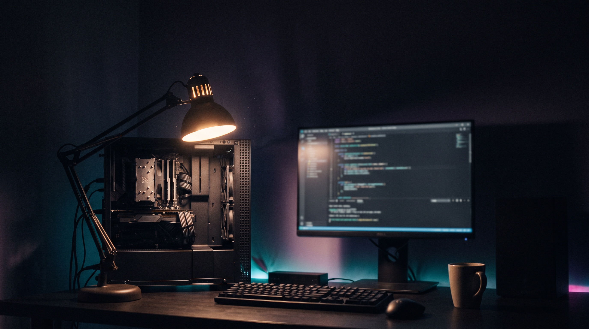

# Hi there, I'm Alfred 👋

**Building software that lives on your machine.** I design, build, and ship local-first AI tools, desktop apps, and developer infrastructure — with a focus on privacy, performance, and clean architectural decisions.

---

---

## 🧠 What I'm working on

- 🤖 **SCAAI** — a personal AI partner that runs locally: files, code, terminal, memory, and automation, all on-device
- 🔁 **Retrace** — a terminal flight recorder: record, replay, analyze, secure
- 🌍 **SCAAI-COMMUNITY** — public community hub for releases, reviews, bug reports, and docs contributions
- ✍️ **systemprompts.site** — the SCAAI blog: architectures, cost analysis, and product deep-dives

---

## 🛠️ Tech & Tools

| Category | Stack |
|---|---|
| **Languages** | TypeScript, JavaScript, Python, HTML/CSS, Shell |
| **Frontend** | React, Vite, Tailwind CSS, shadcn/ui |
| **Desktop** | Electron, Electron Builder |
| **Backend** | Node.js, FastAPI, Supabase, Cloudflare Workers |
| **DevOps** | GitHub Actions, Wrangler, Terraform, Docker |
| **AI/ML** | Local-first inference, prompt engineering, vector memory, RAG pipelines |
| **Security** | Secret management, pre-push guards, audit & hardening workflows |

---

## 🔗 Find me

- 🌐 [systemprompts.site](https://systemprompts.site)
- 📦 [SCAAI-COMMUNITY](https://github.com/Nooran3994/SCAAI-COMMUNITY)
- 🔁 [Retrace](https://github.com/Nooran3994/Retrace)
- 💻 [Nooran3994](https://github.com/Nooran3994)
